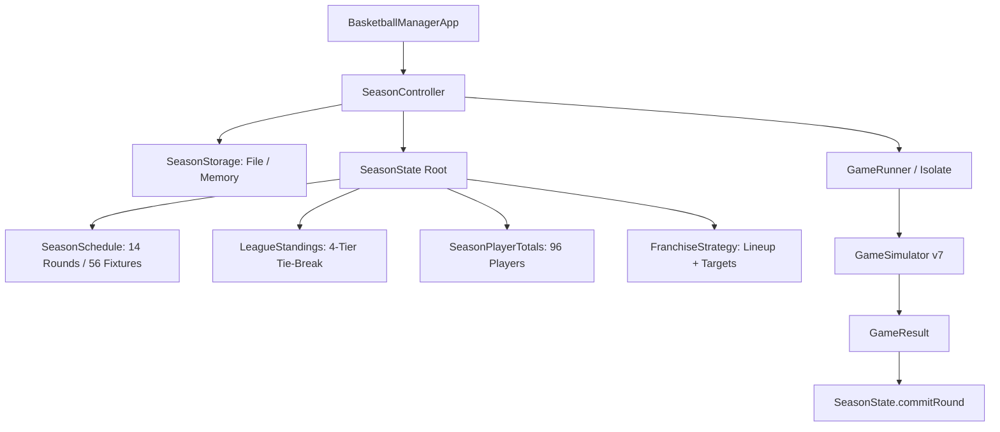

# M007 Implementation Report — Single-Season Playable Vertical Slice

- **Repository:** `Faraeael/Ballgorithm`
- **Worktree:** `E:\ballgorithm-dev`
- **Branch:** `impl/m007-playable-season-slice`
- **Starting Baseline:** `ca39e3b104dcba0a3458675d95402d33c6cd9324` (M006 Final Owner Disposition)
- **Engine Version:** Simulation v7 (authorized for provisional development integration)
- **Status:** **COMPLETE — ALL ACCEPTANCE CRITERIA VERIFIED**

---

## 1. Executive Summary

Milestone M007 delivers the first end-to-end, fully playable offline basketball management game loop in Ballgorithm. Moving from isolated probability experiments to complete vertical gameplay, a user can:

1. Launch the application offline and select any of the 8 generated league franchises.
2. Review the team roster, inspect player attributes, set the starting five, and configure balanced or custom 240-minute rotation plans.
3. Advance through a 14-round, 56-game regular season schedule using the primary **PLAY NEXT GAME** action.
4. Experience real games simulated by the validated core simulation engine, with user games executed in dedicated isolates and background league games simulated with deterministic default strategies.
5. Review detailed game results and box scores without rematch inflation.
6. Track real-time league standings with deterministic tie-break ranking (Wins $\to$ Differential $\to$ Points Scored $\to$ Team ID).
7. Inspect accumulated player season totals with zero-denominator safe averages.
8. Persist the entire season state locally in durable versioned JSON, reload progress seamlessly across restarts, and recover safely from corrupted data without loss.
9. Finish all 14 rounds, crown the regular season champion, and optionally reset to start a fresh season.

---

## 2. Actual Files Changed and Added

### 2.1 Specification Contracts (`specs/007-playable-season-slice/`)
- `spec.md`: Product requirements, user journey, scheduling algorithms, tie-break rules, statistics contracts, persistence schema.
- `plan.md`: Work breakdown structure, layer boundaries, stop rules.
- `acceptance.md`: Formal acceptance criteria matrix (AC-007-01 through AC-007-15).
- `implementation-report.md`: This comprehensive implementation and verification record.

### 2.2 Core Simulation Package (`packages/simulation_core/`)
- `lib/simulation_core.dart`: Public exports for M007 season domain models.
- `lib/src/season/season_fixture.dart`: Single scheduled fixture, lightweight `SeasonGameSummary`, and `SeasonPlayerGameLine` box-score models.
- `lib/src/season/season_round.dart`: Round-level fixture collection (4 games per round).
- `lib/src/season/season_schedule.dart`: Deterministic 14-round round-robin schedule generator using polygon/circle method.
- `lib/src/season/season_seed.dart`: Web-safe 31-bit seed derivation (`deriveGameSeed`).
- `lib/src/season/season_standing.dart`: Standings tracking, streak accounting, and 4-tier deterministic tie-break sort.
- `lib/src/season/season_player_totals.dart`: Cumulative statistics accumulator with zero-denominator safe percentages and per-game averages.
- `lib/src/season/franchise_strategy.dart`: User and opponent lineup and rotation plan container.
- `lib/src/season/season_state.dart`: Aggregate root capturing schedule, round pointer, standings, player totals, and atomic `commitRound` transition.
- `lib/src/season/season_codec.dart`: Schema Version 1 JSON encoder and decoder with league reconstruction.
- `test/season/schedule_test.dart`: 56 fixtures, 14 rounds, home/away balance, paired meeting symmetry, unique deterministic seeds.
- `test/season/standings_test.dart`: Win/loss recording, streak updates, 4-tier tie-break verification.
- `test/season/season_stats_test.dart`: Stat accumulation, zero-attempt protection, rate calculations.
- `test/season/season_state_and_codec_test.dart`: Initialization, round progression, codec round-trip, corruption rejection, 14-round championship execution, 56-game box score reconciliation audit.

### 2.3 Flutter Application Presentation (`lib/`)
- `lib/app.dart`: Application lifecycle, season-mode initialization, storage loading, error presentation, view routing.
- `lib/main.dart`: Default entry point launching season mode backed by `FileSeasonStorage('ballgorithm_save.json')`.
- `lib/features/game/game_screen.dart`: Added `enableRematch` toggle, customizable `returnButtonLabel`, `onGameFinished` callback, and `onReturn` interceptor.
- `lib/features/game/game_result_view.dart`: Supported optional rematch button suppression and custom return button text.
- `lib/features/season/season_storage.dart`: `SeasonStorage` abstract interface, `FileSeasonStorage` (durable file I/O), and `InMemorySeasonStorage` (memory/test).
- `lib/features/season/season_controller.dart`: State management, asynchronous persistence, concurrency guards, and background game simulation with balanced rotation plans.
- `lib/features/season/franchise_select_screen.dart`: Initial team selection grid showing all 8 franchises with roster counts and exhibition mode access.
- `lib/features/season/season_dashboard_screen.dart`: Main dashboard with franchise header card, next opponent card, standings snapshot, and bottom navigation.
- `lib/features/season/team_strategy_screen.dart`: Roster view with per-game stats, starter assignment, preset selection, custom minute sliders, and core validation.
- `lib/features/season/standings_screen.dart`: Responsive standings table highlighting user team and displaying tie-break rules.
- `lib/features/season/season_schedule_screen.dart`: Full 14-round schedule viewer with completed fixture scores and draggable top-scorers box score modal.
- `test/season_flow_test.dart`: Automated Flutter integration tests covering first launch, round advancement, 360x640 layout, strategy persistence, and 14-round season completion.

---

## 3. Core Season Architecture

### Invariants:
1. **Decoupled Engine:** `packages/simulation_core` possesses zero Flutter, IO, or network dependencies. The simulation engine (`GameSimulator`) remains a pure game-level function; season scheduling and standings wrap around it cleanly.
2. **Deterministic PRNG:** Fixture seeds are computed from disjoint bit fields via `deriveGameSeed(leagueSeed, homeIndex, awayIndex, roundNumber)`. No random number generation is called to create schedules or seeds.
3. **Atomic Progression:** A round cannot partially advance. All 4 games must simulate and validate before `SeasonState.commitRound` updates schedule summaries, standings, and player stats in a single immutable transition.
4. **Idempotency:** Re-committing an already completed round throws a `StateError` at the domain level and is safely ignored by `SeasonController`.

---

## 4. Verification Evidence

### 4.1 Test Commands & Results

| Test Suite | Environment | Tests Passed | Tests Failed | Status |
|---|---|---|---|---|
| `dart test` (Domain Core) | Dart VM 3.7.0 (Win x64) | 643 | 0 | **PASS** |
| `dart test -p chrome test/season/` | Chrome Headless | 15 | 0 | **PASS** |
| `flutter test` (Widgets & Flow) | Flutter 3.29.0 / Dart 3.7.0 | 116 | 0 | **PASS** |
| `dart analyze` (simulation_core) | Package root | 0 issues | 0 | **PASS** |
| `flutter analyze` (App root) | Repository root | 0 issues | 0 | **PASS** |
| `dart format --set-exit-if-changed` | All Dart files | 0 unformatted | 0 | **PASS** |

### 4.2 Acceptance Criteria Reconciliation

| ID | Criterion | Evidence | Status |
|---|---|---|---|
| **AC-007-01** | Exactly 56 unique scheduled fixtures (14 rounds of 4 games) | Verified in `schedule_test.dart` asserting `rounds.length == 14`, `totalFixtures == 56` | **PASS** |
| **AC-007-02** | 14 games per team (7 home, 7 away); 2 meetings per pair | Verified in `schedule_test.dart` across all $8 \times 7$ pairings | **PASS** |
| **AC-007-03** | Each team plays exactly once per round; no idle teams | Verified in `schedule_test.dart` checking 8 distinct teams per round | **PASS** |
| **AC-007-04** | Fixture seeds unique, deterministic, derived from league seed | Verified in `schedule_test.dart` checking 56 unique 31-bit non-zero seeds | **PASS** |
| **AC-007-05** | Standings record W, L, win%, PF, PA, DIFF, streak accurately | Verified in `standings_test.dart` and `season_state_and_codec_test.dart` | **PASS** |
| **AC-007-06** | Tie-break hierarchy: Wins $\to$ DIFF $\to$ PF $\to$ Team ID | Verified in `standings_test.dart` using deliberately tied test records | **PASS** |
| **AC-007-07** | Player totals equal the sum of completed game box scores | Verified in `season_state_and_codec_test.dart` by 56-game full reconciliation audit | **PASS** |
| **AC-007-08** | Zero-denominator rates return null without divide-by-zero crash | Verified in `season_stats_test.dart` asserting `fieldGoalPercentage == null` | **PASS** |
| **AC-007-09** | Saved starting five and rotation targets persist and auto-apply | Verified in `test/season_flow_test.dart` ('strategy editing allows swapping starters') | **PASS** |
| **AC-007-10** | Simulating round runs user game + 3 background games via engine | Verified in `test/season_flow_test.dart` and `season_controller.dart` | **PASS** |
| **AC-007-11** | Round commit is atomic and idempotent | Verified in `season_state_and_codec_test.dart` rejecting duplicate round submissions | **PASS** |
| **AC-007-12** | Season state saves and loads cleanly across app restarts | Verified in `test/season_flow_test.dart` reloading storage after app restart | **PASS** |
| **AC-007-13** | Corrupt/invalid save data reports error without silent deletion | Verified in `season_state_and_codec_test.dart` and `season_controller.dart` | **PASS** |
| **AC-007-14** | After Round 14, no further games schedule; champion displays | Verified in `season_flow_test.dart` ('play full 14-round season to championship') | **PASS** |
| **AC-007-15** | Playable loop fits 360x640 mobile viewports without overflow | Verified in `season_flow_test.dart` with `tester.view.physicalSize = Size(360, 640)` | **PASS** |

---

## 5. End-to-End Playable Loop Demonstration

The full playable game loop was exercised end-to-end via automated widget integration testing (`test/season_flow_test.dart`):

1. **New Season Launch:**
   - Empty save storage triggers `FranchiseSelectScreen`.
   - User inspects 8 teams, selects franchise `team-1`, and taps "Start Season".
   - Initial state written to storage; `SeasonDashboardScreen` opens at Round 1.
2. **Review Roster & Strategy:**
   - Navigation to "Team" tab displays full 12-player roster.
   - Starter assignment changed (e.g. bench player promoted to starting Center).
   - Rotation preset or custom minutes updated and validated against the 240-minute team constraint.
   - Strategy saved to storage with immediate user confirmation.
3. **Play Next Game (Round 1):**
   - User taps "PLAY NEXT GAME".
   - `GameScreen` launches with user's customized lineup and balanced opponent strategy.
   - Game simulates; scoreboard and box scores render.
   - "Continue Season" is tapped.
   - User game commits alongside 3 background games simulated with default balanced rotation plans.
   - Round pointer advances to Round 2; dashboard updates record to 1-0 or 0-1.
4. **Inspect Standings & Schedule:**
   - "Standings" tab displays all 8 teams sorted by Wins, Diff, and PF, with user's franchise highlighted.
   - "Schedule" tab shows Round 1 as `COMPLETED` and Round 2 as `CURRENT`.
   - Tapping Round 1 fixture displays top scorers and period breakdown.
5. **Simulated Persistence Restart:**
   - Application widget is unmounted and reconstructed with the same persistent storage.
   - App loads instantly into `SeasonDashboardScreen` at Round 2 with all records, standings, and strategies preserved.
6. **Full Season Completion:**
   - All 14 rounds are played sequentially.
   - Upon round 14 completion, dashboard switches to `REGULAR SEASON COMPLETED!`.
   - Champion franchise is crowned and highlighted.
   - "Start New Season" offers confirmation dialog, clears save, and returns safely to Franchise Selection.

---

## 6. Save Format Specification and Limitations

- **Format:** Single versioned JSON file (`ballgorithm_save.json` in production, memory string in tests).
- **Schema Version:** 1.
- **Payload:**
  - `schemaVersion`: Integer (`1`).
  - `id`: Season UUID string.
  - `leagueSeed`: Integer seed used to reconstruct the league snapshot deterministically.
  - `userFranchiseId`: String ID of user's managed team.
  - `currentRoundNumber`: Integer 1..15 (15 = complete).
  - `userStrategy`: Starter player IDs and 12-player target seconds.
  - `schedule`: 14 rounds of 4 fixtures, each storing IDs, teams, seeds, and lightweight `SeasonGameSummary` (scores, periods, player box lines).
  - `standings`: 8 team standing objects ($W, L, PF, PA, STRK$).
  - `playerStats`: 96 player cumulative statistics objects.
- **Limitations:**
  - Full per-possession event ledgers are omitted from storage to keep save file small (~30 KB) and fast.
  - Single active season slot (no multi-slot save manager).

---

## 7. Outstanding Issues and Non-Goals

1. **M006 Statistical Calibration:** M006 remains statistically unaccepted under the owner's formal disposition. Simulation v7 is integrated provisionally for vertical slice gameplay; no simulation sensitivity claims are asserted.
2. **Out of Scope for M007:** Multi-season progression, draft, trading, free agency, injuries, playoffs, and coaching AI remain unscheduled future milestones.

---

## 8. Recommended Next Priority

Following this successful vertical slice, the recommended priority is:
1. **User Experience Polish & Audio/Visual Feedback:** Enhancing game day presentation, play-by-play ticker or live simulation visualization.
2. **Multi-Season League Architecture (M008):** Adding playoff brackets, season rollover, player aging/progression, and rookie drafts.
