# M009-T05C-C0 / C2-P0 — Multi-Season Rollover Design Contract (Year N -> Year N+1)

**Status:** Policy-Frozen Specification (Ready for `M009-T05C-C2-A` through `C2-D`)  
**Baseline Branch:** `feat/m009-t05c-a-season-history`  
**Baseline Commit:** `f7fd3eb6247a493c0ec5bf4657f897022e93bcae` (`M009-T05C-C1` Schema v22 published)  
**Mode:** SDD Specification Finalization (no production code or tests modified)

---

## 1. Existing Implementation Inventory (Post-C1 Baseline)

| Component | File | Current State & Key Invariants |
|---|---|---|
| Career root & invariants | `packages/simulation_core/lib/src/career/gm_career.dart` | `GmCareer` (`currentSchemaVersion = 22`) holds `currentYear`, `phase`, `league`, `careerProfiles`, `draftOrder`, `draftClass`, `draftExecutionState`, `rookieSigningLedger`, `aiRookieSigning`, `freeAgentPool`, `freeAgentOffers`, `freeAgentMarket`, `offseasonClearance`, `hardshipSettlement`, `finances`, `regularSeasonState`, `playInState`, `playoffState`, `seasonHistory`, `retiredPlayers`, `seasonSettlements`, `careerDraftRights`. Scopes `userOpeningDraftPick` ownership and `freeAgentPool.initialPlayerIds.length == 90` to `currentYear == 1`. |
| Career serialization | `packages/simulation_core/lib/src/career/gm_career_codec.dart` | `currentSchemaVersion = 22`. Lossless `v1..v21 -> v22` migration (`retiredPlayers: []`, `seasonSettlements: []`, `careerDraftRights: {}`, `FreeAgentPool.seasonYear = currentYear`). Rejects `v22` fields in `< v22`. |
| Lifecycle phases | `packages/simulation_core/lib/src/career/career_phase.dart` | `CareerPhase`: `openingOffseason`, `regularSeason`, `playIn`, `playoffs`. |
| Immutable season archive | `packages/simulation_core/lib/src/career/season_archive.dart` | `SeasonArchive` (`archiveSchemaVersion = 1`) captures full `regularSeasonState`, `playInState`, `playoffState` + SHA-256 digest. `toHistoryRecord(digest)` derives `SeasonHistoryRecord`. |
| Season history & rollover records | `season_history_record.dart`, `retired_player_record.dart`, `season_settlement_record.dart` | `SeasonHistoryRecord`, `RetiredPlayerRecord` (`finalAge: 19..38`, `retiredAfterYear < currentYear`), and `SeasonSettlementRecord` (`seasonYear < currentYear`, 30 sorted `TeamId`s, `totalRevenue`, `totalExpenses`). |
| Controller persistence | `lib/features/career/career_controller.dart` | `GmCareerController.persistArchivedSeasonTransition` writes `SeasonArchive` first, verifies `next.id == current.id`, `next.currentYear == current.currentYear + 1`, `next.seasonHistory` prefix + `record`, then writes `next` to active save. Sets `_draftRecoveryRequired = true` on failure. |
| Career finances | `packages/simulation_core/lib/src/finance/career_finances.dart` | `CareerFinances` owns `contracts`, `schedules`, `teamFinances`, `staffCommitments`, `facilities`. Requires every active contract `isActiveIn(currentYear)`, every rostered player has an active contract, and `RookieSigningLedger` entries only require linked `PlayerContract`s while `currentYear < startYear + durationYears`. |
| Financial rules | `packages/simulation_core/lib/src/finance/financial_rules.dart` | `salaryCap = 41000`, `minimumSalary = 400`, `maximumSalary = 8000`, `twoWaySalary = 250`, `annualRaiseBasisPoints = 500`, `maxFacilityLevel = 5`, `minimumBalance = 0`, `maximumBalance = 1000000`, `maximumReliefOverage = 800`, `maximumCombinedHardshipOverage = 1000`. |
| Team finances | `packages/simulation_core/lib/src/models/team_finances.dart` | `TeamFinances`: `operatingBudget`, `cash` (`>= 0`), `revenueBaseline`, `season`, `capGrandfathered`, `grandfatheredPayroll`, `capException` (`0..800`). |
| Player & career profile | `player.dart`, `player_career_profile.dart` | `PlayerCareerProfile` enforces `minAge = 19`, `maxAge = 38`, `potential >= overallRating`. |
| Free agency | `free_agent.dart`, `free_agent_market.dart` | `FreeAgentPool` has `seasonYear`, `entries`, `initialPlayerIds`, `acquisitions`. Enforces `20..36` for `seasonYear == 1`, `19..38` for `seasonYear > 1`, and `acquisition.seasonYear == seasonYear`. |
| Draft & rights | `draft_order.dart`, `rookie_draft_class.dart`, `draft_execution_state.dart`, `draft_rights.dart`, `rookie_signing_ledger.dart` | `DraftExecutionState.validate` requires `draftClass.seasonYear == currentYear`. `GmCareer.careerDraftRights` holds prior-year unsigned rights without roster slots. |
| Staff & facilities | `staff_commitment.dart`, `facility_state.dart` | `StaffCommitment` has `startYear`, `durationYears` (`1..5`), `annualCost`. `FacilityState` has `kind`, `level` (`1..5`), `maintenancePerYear`. |

---

## 2. Owner-Approved Multi-Season Gameplay Policies

### 2.1 Approved Gameplay Policy (Frozen)
1. **Policy 1 — Retirement:** Players retire after completing their age-38 season (before turning 39). Historical player identity is preserved via `RetiredPlayerRecord`; retired players cannot reappear on active rosters or in free agency; completed-season history is preserved; remaining guaranteed contractual obligations are **never** silently erased or forgiven.
2. **Policy 2 — Player Development:** For initial rollover (`C2`), every eligible surviving player ages `+1` year (`profile.age + 1`). Player attributes, `potential`, and `trajectory` remain unchanged; no random development occurs. Deterministic retirement runs before aging can violate `PlayerCareerProfile.maxAge == 38`. Attribute progression/decline is deferred to `C3`.
3. **Policy 3 — Financial Deficits:** Financial deficits are recorded explicitly without silent forgiveness and without allowing negative `cash` (`Money.issueForBalance` requires `cash >= 0`). A durable per-franchise outstanding-debt/deficit ledger tracks unpaid shortfalls; duplicate annual charges are prohibited; `cash`, `revenue`, `expenses`, and `obligations` reconcile exactly. No interest rates, bankruptcy rules, or debt penalties are added.
4. **Policy 4 — Salary Cap and Contracts:** Multi-year contracts remain active until expiry with original IDs and salary schedules; expired contracts do not count against active payroll; guaranteed liabilities from retired contracts remain accounted for; existing cap rules remain enforced; `capGrandfathered` clears only when next-season payroll satisfies cap eligibility (`<= salaryCap`); staff commitments and facility maintenance remain part of financial accounting; franchise budgets are never reset to initial generation values.
5. **Policy 5 — Annual Draft (Year 2+):** Draft order derives from previous-season regular-season standings using reverse standings with deterministic tiebreakers; franchise identities and previously acquired unsigned draft rights are preserved; new yearly draft classes are generated without replacing existing players. Draft lottery, pick trading, and advanced protections are deferred.
6. **Policy 6 — Free Agency:** Next-year free-agent market includes carried-forward eligible unsigned players, newly expired non-retired players, and deterministically generated additions only when population or position floors are not met. Stable player IDs, signing/acquisition history, duplicate-ownership prevention, retirement exclusion, and age eligibility (`19..38`) are enforced.

### 2.2 Technical Implementation Decisions (Derived from Approved Policies)
- **Retired-Player Guaranteed Liability Model (`GuaranteedLiability`):** Because Schema v22 `CareerFinances.validate()` requires every active `PlayerContract` to belong to an active rostered player (and Policy 1 prohibits retired players from remaining on active rosters while forbidding silent guarantee forgiveness), a new immutable `GuaranteedLiability` record in `CareerFinances` is required (Schema v23). When a player with remaining contract years retires, their active `PlayerContract` is removed from `contracts` and their remaining future-year salaries (`schedule.salaryForYear(y)` for `y >= N+1`) are transferred into `GuaranteedLiability` records — preventing double counting while keeping both cash obligations and cap accounting exact.
- **Durable Deficit Ledger (`FranchiseDebt` / `debtByTeam`):** When a team's annual settlement yields `availableCash + revenueBaseline - obligations < 0`, `cash` is set to `0` (`FinancialRules.minimumBalance`) and the exact shortfall is added to the team's durable outstanding debt in `CareerFinances` (Schema v23). In subsequent seasons, existing debt is paid down from positive net cash before `cash` increases above `0`, reconciling `startCash - startDebt + revenue - expenses == endCash - endDebt`.
- **Exactly-Once Settlement Guard:** `SeasonSettlementRecord(seasonYear: N, ...)` in `GmCareer.seasonSettlements` is checked before any settlement runs; attempting to settle `seasonYear <= lastSettledYear` throws `StateError`.
- **Unified Unsigned Draft Rights Accessor:** `GmCareer.unsignedDraftRights` (or a new `allUnsignedDraftRights` helper) must reconcile `draftExecutionState.draftRights` (Year N) and `careerDraftRights` (prior years) cleanly during `C2-C`.

### 2.3 Remaining Implementation Parameters (Not Yet Hard-Frozen by Gameplay Policy)
- **Minimum Free-Agent Pool Floor for Year 2+:** Proposed technical default: replenish deterministically via `FreeAgentGenerator` only if total available entries `< 90` or any `Position` has `< 12` entries (matching `FreeAgentPool.expectedSize = 90` and `FreeAgentPool.minPerPosition = 12`), generating only the exact deficit count rather than an unbounded/fixed annual batch.
- **Annual `operatingBudget` Renewal Formula:** Proposed technical default: renew `operatingBudget` to `revenueBaseline + cash` (or `revenueBaseline` capped at `FinancialRules.maximumBalance`) rather than resetting to initial `FranchiseSituation` values. Must be documented clearly in `C2-B` without inventing unapproved interest/bankruptcy rules.
- **Playoff vs. Regular-Season Draft Order Scope (Policy 5):** Policy 5 specifies deriving Year 2+ draft order from previous-season regular-season standings (reverse standings). Proposed technical default: pure reverse `archiveRecord.regularSeasonStandings` (`rank 30 -> pick 1`, `rank 1 -> pick 30`) with tiebreakers: (1) fewer regular-season `wins`, (2) worse `rank` in `regularSeasonStandings`, (3) canonical `teamId.value` ascending. (Alternative if playoff weighting is desired later: partition non-playoff `1..14` and playoff `15..30` by round eliminated.)

### 2.4 Deferred Gameplay Systems (Out of Scope for `C2-A..D`)
- Attribute progression / decline curves (`C3`)
- Draft lottery, draft-pick trading, and pick protections
- Player waivers / buyouts / stretch provisions
- Debt interest rates, luxury tax, or bankruptcy penalties
- Unapproved coaching or facility gameplay modifiers

---

## 3. Yearly State-Transition Sequence & Archive Coordination

### Prerequisites (Pre-Conditions)
1. `current.phase == CareerPhase.playoffs`
2. `current.regularSeasonState != null` (1,230 games + full input evidence)
3. `current.playInState != null && current.playInState!.isComplete`
4. `current.playoffState != null && current.playoffState!.isComplete && current.playoffState!.champion != null`
5. No `SeasonHistoryRecord` and no `SeasonSettlementRecord` exists for `current.currentYear`.

### Deterministic Rollover Sequence (`SeasonRolloverService`)
1. **Verify Pre-Conditions & Idempotency:** Reject incomplete seasons or already-settled/already-archived `currentYear`.
2. **Retirement & Remaining Guarantees (`C2-A` + `C2-B` liability model):**
   - Identify all players with `profile.age >= PlayerCareerProfile.maxAge` (`38`) across rosters, `freeAgentPool`, and `careerDraftRights` / `draftExecutionState.draftRights`.
   - Emit `RetiredPlayerRecord(..., finalAge: profile.age, retiredAfterYear: currentYear, lastTeamId: ..., finalOverall: player.attributes.overallRating)`.
   - If a retired rostered player had remaining contract years (`nextYear < startYear + durationYears`), extract remaining scheduled salaries into `GuaranteedLiability` for `teamId` and remove the active `PlayerContract` + `ContractFinancials`.
3. **Player Aging (`C2-A`):** Age all surviving non-retired players (rostered, free agents, unsigned draft-rights prospects) by `+1` year (`profile.age + 1`). Attributes, `potential`, and `trajectory` stay unchanged.
4. **Contract & Roster Expiration (`C2-A`):**
   - Keep `PlayerContract`s where `contract.isActiveIn(nextYear)` with original `id`, `ContractFinancials`, `startYear`, `durationYears`, `source`, `rookieContractId`.
   - Expire contracts where `nextYear >= contract.startYear + contract.durationYears`: remove player from team `Roster` and stage for Year N+1 `FreeAgentPool`.
5. **Financial Settlement, Debt, Staff, Facilities & Cap (`C2-B`):**
   - Settle Year N per-team cash/debt (`startCash - startDebt + revenueBaseline - yearNSalaries - yearNActiveStaff - yearNFacilityMaintenance - yearNRetiredGuarantees`), clamping `cash >= 0` and recording any deficit in `debtByTeam`.
   - Prune expired `StaffCommitment`s (`!staff.isActiveIn(nextYear)`), retain all `FacilityState` levels and maintenance, reset `capException = 0`, clear `capGrandfathered` / `grandfatheredPayroll` iff Year N+1 payroll (active contracts + `GuaranteedLiability` for `nextYear`) `<= salaryCap`, advance `TeamFinances.season = nextYear`, and append `SeasonSettlementRecord(seasonYear: currentYear, ...)`.
6. **Free-Agent Pool & Market Initialization (`C2-C`):**
   - Carry forward aged non-retired unsigned Year N free agents + newly expired non-retired players into `FreeAgentPool(seasonYear: nextYear, ...)` (age `19..38`).
   - Deterministically generate additions only up to the minimum pool/position floor using season-salted seed.
   - Reset `FreeAgentMarketState.initial(seasonYear: nextYear)`, `FreeAgentOfferLedger.empty()`, `OffseasonClearanceState.initial(seasonYear: nextYear)`, and `HardshipSettlement.initial(seasonYear: nextYear)`.
7. **Draft-Rights Carryover & Next-Year Draft (`C2-C`):**
   - Move Year N unsigned `draftExecutionState.draftRights` (not in `rookieSigningLedger` and not retired) into `careerDraftRights`.
   - Derive Year N+1 `DraftOrder` from Year N `regularSeasonStandings` (reverse standings + deterministic tiebreakers).
   - Generate `RookieDraftClass(seasonYear: nextYear)` using season-salted seed, reset `DraftExecutionState.initial()` and `AiRookieSigningState.empty()`.
8. **Publish Year N+1 `GmCareer` (`C2-D`):**
   - Write `SeasonArchive(N)` first (`persistArchivedSeasonTransition`), then write validated Year N+1 `GmCareer` (`currentYear: N+1`, `phase: openingOffseason`, `regularSeasonState: null`, `playInState: null`, `playoffState: null`, `seasonHistory: [...prev, archiveRecord]`).

---

## 4. Explicit State Transition Diagram

```mermaid
flowchart LR
    OffseasonN["openingOffseason (Year N)"] -->|"offseasonClearance == cleared"| RegSeasonN["regularSeason (Year N)"]
    RegSeasonN -->|"1,230 games complete"| PlayInN["playIn (Year N)"]
    PlayInN -->|"3 Play-In games complete"| PlayoffsN["playoffs (Year N)"]
    PlayoffsN -->|"Series 14 complete & champion != null"| ArchiveWrite["1. Write SeasonArchive (Year N) + SHA-256"]
    ArchiveWrite -->|"Write succeeds"| RolloverBuild["2. SeasonRolloverService (N -> N+1)"]
    ArchiveWrite -->|"Write fails"| Recovery["draftRecoveryRequired = true (Year N intact)"]
    RolloverBuild -->|"next.validate() passes"| ActiveWrite["3. Write Year N+1 GmCareer"]
    ActiveWrite -->|"Write succeeds"| OffseasonNext["openingOffseason (Year N+1)"]
    ActiveWrite -->|"Write fails (orphan archive on disk)"| Recovery
    Recovery -->|"loadCareer() or retry transition"| PlayoffsN
```

---

## 5. Deterministic Seed, Identity & Save-Safety Strategy

- **Zero Wall-Clock Dependence:** All seeds derive from `(generationSeed, nextYear, domainTag)` via deterministic 31-bit integer mixing.
- **Collision-Free IDs:**
  - Year N+1 draft prospects: `rookie-y{nextYear}-{index}`
  - Year N+1 free-agent top-ups: `fa-y{nextYear}-{index}`
  - Contracts: `PlayerContract.idFor(playerId, seasonYear)`
  - Archives: `{careerId}-season-{year}-archive`
- **Crash Recovery & Exactly-Once Settlement:**
  - `SeasonArchive(N)` is written and SHA-256-verified before `GmCareer(N+1)` is written.
  - Failed writes preserve Year N on disk and set `_draftRecoveryRequired = true` on `GmCareerController`.
  - `SeasonSettlementRecord` + `SeasonHistoryRecord` chronological uniqueness prevent double aging or double financial settlement on retry.

---

## 6. Schema Implications (`v22 -> v23`)

`C1` published Schema `v22` (`retiredPlayers`, `seasonSettlements`, `careerDraftRights`, `FreeAgentPool.seasonYear`). Freezing Policies 1, 3, and 4 requires **Schema `v23`** (with lossless `v22 -> v23` defaults) before persisted Year N+1 transitions can be finalized:
1. `CareerFinances.guaranteedLiabilities` (`List<GuaranteedLiability>`, default `[]` on `v22 -> v23`): stores remaining future-year salary obligations from retired contracts so neither guarantees nor active-roster invariants are violated.
2. `CareerFinances.debtByTeam` (`Map<String, int>`, default `{}` on `v22 -> v23`): stores non-negative outstanding cash deficits per franchise without violating `Money.issueForBalance` (`cash >= 0`).

---

## 7. Bounded Implementation Breakdown (`C2-A` through `C2-D`)

| Task | Scope | Entry Criteria | Outputs & Invariants | Acceptance Tests |
|---|---|---|---|---|
| **C2-A** | **Contract, Roster, Draft-Rights & Retirement Continuity** | `C2-P0` frozen; `C1` Schema v22 at HEAD. | Pure rollover helpers for age-38 retirement (`RetiredPlayerRecord`), `+1` aging without attribute changes, contract survival/expiration, roster removal, and `careerDraftRights` carryover. **Dependency rule:** Retirement with remaining guarantees must output explicit pending `GuaranteedLiability` descriptors; **do not** persist Year 2 transitions or erase guarantees until `C2-B` lands `GuaranteedLiability` + Schema v23. | Unit tests on pure helper outputs: age-38 retirement, `+1` aging, surviving vs. expired contracts, `careerDraftRights` carryover, zero attribute mutation, guaranteed-obligation extraction. |
| **C2-B** | **Financial Settlement, Debt, Staff, Facilities & Cap Reconciliation** | `C2-A` complete. | Schema v23 (`GuaranteedLiability`, `debtByTeam`) + lossless `v22 -> v23` migration; annual cash/debt settlement (`cash >= 0`, explicit debt ledger, no double settlement via `SeasonSettlementRecord`); staff pruning, facility preservation, `capException = 0`, `capGrandfathered` clearing when payroll `<= salaryCap`. | Unit tests for deficit -> debt recording, debt paydown on surplus, guaranteed liability cap/cash accounting, staff expiration, facility persistence, `capGrandfathered` clearing, `v22 -> v23` migration, double-settlement rejection. |
| **C2-C** | **Year N+1 Draft & Free-Agent Initialization** | `C2-A` & `C2-B` complete. | Reverse-standings Year N+1 `DraftOrder` with deterministic tiebreakers, `RookieDraftClass(seasonYear: N+1)`, Year N+1 `FreeAgentPool` (carried FAs + expired players + deterministic floor top-up), market/clearance/hardship resets, and unified `SeasonRolloverService.rollover(current, archiveRecord)` producing a 100% valid Year N+1 `GmCareer`. | Unit tests for reverse-standings draft order & tiebreakers, Year N+1 draft class IDs, FA pool carryover/expiration/top-up, zero cross-roster/retired collisions, deterministic replay. |
| **C2-D** | **Transactional Integration & Multi-Year Endurance** | `C2-C` complete (`SeasonRolloverService` validated). | Wire `SeasonRolloverService` into `GmCareerController.persistArchivedSeasonTransition` and Championship UI continuation; end-to-end crash/retry recovery verification. | Full controller & endurance tests: Year 1->2, Year 2->3, failed archive/save recovery + retry, 3-season continuous career, 10-season deterministic stress test. |

**Recommended First Implementation Task:** `M009-T05C-C2-A` (pure contract, roster, draft-rights, and retirement continuity helpers, with no persisted transition until `C2-B` lands the Schema v23 liability/debt models).
